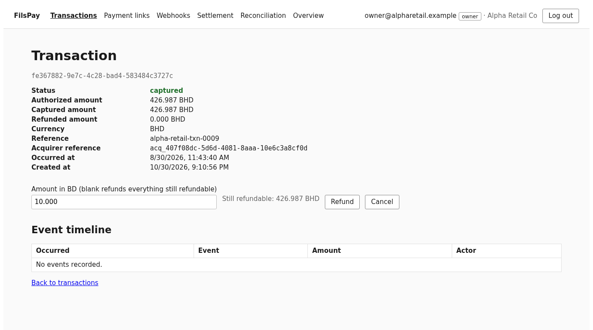
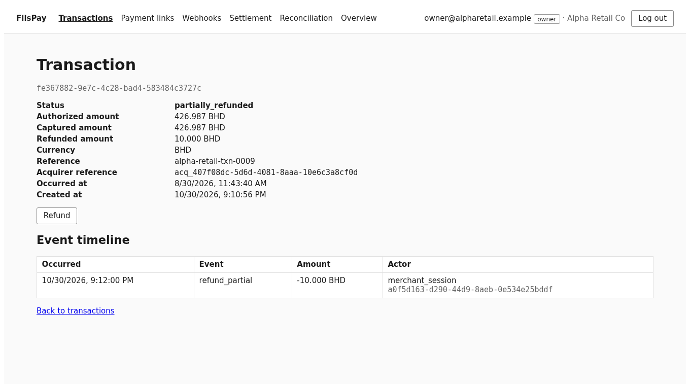
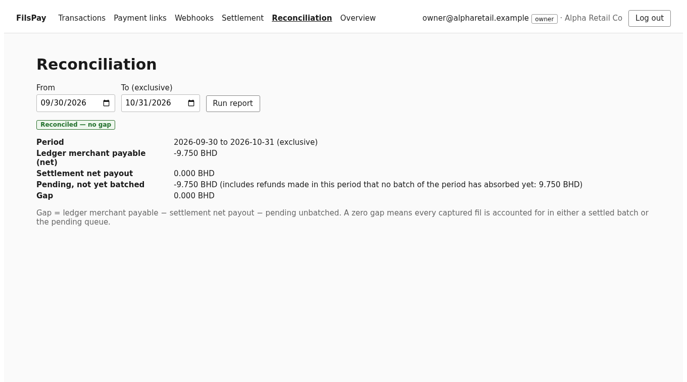
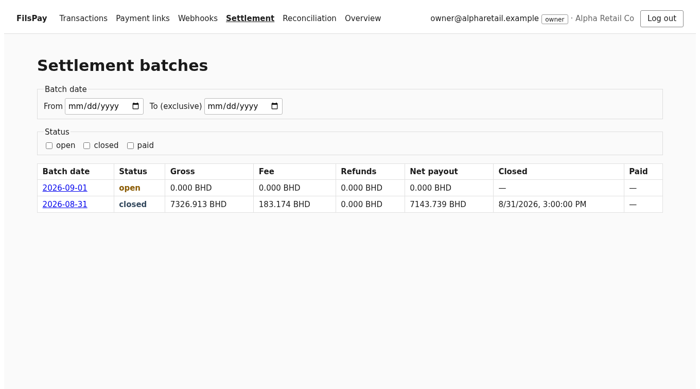

# fries: FilsPay audit and build

**Team:** fries · **Ayoub** (`kohiba4`): money, settlement, data, FP-300 refunds core, TOTP login, hosting, load test · **The-Tifo**: API security, integrations, refund webhook/reports/UI

- 61 findings · 51 fixed with a failing test first · refunds built end to end · one server, 1 vCPU / 2 GB
- Live: `https://157-245-105-203.sslip.io` · admin `:8443` · API `/v1`

---

## Root cause

**Safety was asserted in comments, not enforced by the system.**

- "unique index exists", "locked", "role-gated", "idempotent", "Claude checked": the mechanism was missing
- Symptoms it explains: duplicate payouts (no unique key), double refunds and double charges (no lock), support users capturing (no role gate), login without the second factor, a ledger that got slower with every checkout (no index)
- Plus money-specific faults: float32 payouts, 2-decimal parsing of a 3-decimal currency (10× error), a 32-bit counter, UTC days used as Bahrain days
- Even the repo's agent files were traps ("money is cents", "never modify tests"): we treated every comment as untrusted data

---

## Key findings (ranked by impact)

| # | Finding | Evidence |
|---|---|---|
| 1 | Pre-OTP session authenticates every merchant route; OTP bound to another tenant's user (AUD-001/002) | login without the second factor reproduced; tests fail with the fix reverted |
| 2 | Payment link charged twice (AUD-006); refunds without ownership/lock (AUD-003/004) | incident 2026-05-14 reproduced; 6000+6000 on 10000 → one 200, one 422 now |
| 3 | Money wrong to the fil: CSV import 10× too small (AUD-012), float32 net payout (AUD-008), scheme file rounded up (AUD-010) | 4.75 BD posted 475 fils; 1M BD net off by up to 14 fils |
| 4 | Duplicate payout notifications/disbursements (AUD-018); "rebuild balances" 136.5M vs 7.3M (AUD-015) | 35–37 of 40 batches duplicated; unique indexes now exist |
| 5 | The ledger scanned in full on every capture (AUD-061) | `EXPLAIN`: 42,943 rows filtered per capture; throughput ×2 after two indexes |

---

## Fixes and proof

- Every fix: **failing test first**, minimal root-cause change, full suites, re-attack, finding file with root cause and effect on data
- API 470 tests, reporting 14, web 8, admin 3, money 40, scripts 14; Go all green except one **intentionally red** repro (AUD-048, decision pending)
- **19 independent reviews** by a read-only subagent on a `git archive` (found real errors in our own claims, see AI slide)
- Not every report item was a bug: AUD-037 (by design), AUD-041 (test pollution): recorded in `TRIAGE.md`
- Migrations 0001→0095 apply cleanly on a fresh database (AUD-026)

---

## Live demo: full and partial refund, end to end

- Partial refund 10.000 BD of 426.987 BD → `partially_refunded`, `refund_partial` −10.000, fee given back proportional and capped
- Batch close: payout = gross − fee − refunds + fee given back; reconciliation still **0.000 BD gap**
- Webhook `refund.succeeded`, reporting totals, timeline: all driven by the same ledger rows

---

## Refunds in the settlement report

- Screenshots ready in case the live demo fails (taken from a real session)
- Negative net (refunds above captures): pays nothing, debt visible; recovery policy = open decision Q13

---

## Under load

- One server: nginx (TLS) → API (**0.5 vCPU / 512 MB**, systemd) → Postgres; reporting worker; Go settlement daemon
- **Estimated 30 checkouts/s (~300 users at a 10 s think time). Measured: 30.2 checkouts/s, capture p95 1.0 s, 0 real errors**
- Bottleneck: the database on the single vCPU. We found it by measuring: API 60 % idle → `pg_stat_activity` → `EXPLAIN` → ledger balance trigger with no index
- Overload: new checkouts turned away with **503 in tens of ms** (admitted captures never rejected); pool exhaustion → 503 + `Retry-After`, not 500
- `kill -9` under load: back in **~5 s**, 0 unbalanced groups, 0 lost captures (10,279 = 10,279)

---

## How we used AI

**Setup in one line:** one instruction file with a trap checklist, a read-only *skeptical reviewer* subagent on every fix, a generated findings report: all in the repo.

**One time the AI was wrong, and how we caught it:** I wrote that the old admin date bug "was also wrong for UTC browsers in the opposite window". The reviewer *ran* the old code under four time zones: identical results: the claim was false. We corrected the finding. Same pattern: a "refunds on by default" switch I set was caught by the reviewer (negative nets were forgiven); a comment saying "impersonators can't refund" was false (`super_admin` → `owner`).

---

## Decisions and open risks

- **Not run on purpose:** March sweep `--apply`, `expire_holds` on real data, historical data repairs (read-only queries written)
- **Open:** negative refund net recovery (Q13), balance definition (AUD-048), fee at capture vs settlement (AUD-016), credit MDR reversal (AUD-050)
- **Security trade-offs:** authenticator secret shown once at first login (password-only attackers can enrol first / lock an account 15 min); admin console public (IP allow-list proposed); free `sslip.io` hostname
- **Environment:** the acquirer is a simulator; one API replica assumed

---

## Appendix (not presented)

- Findings report, root causes, decisions: submission document §4 and `docs/audit/REPORT.md`
- Load test method and raw numbers: submission §3, `deploy/loadtest/`, `docs/audit/LOAD-TEST.md`
- Architecture, deploy, secrets: submission §2, `deploy/`
- Reviews: `docs/audit/reviews/` · Traps found: `docs/audit/suspicious/`
