Every screenshot is a real browser session (headless Chrome driven through the DevTools protocol by `deploy/screenshots/shoot.ts`) against the code of this repository and its seeded data. **Before** = the original challenge repository (`origin/main` built as shipped) or, where the old behaviour is a runtime mode, the same app with the original second factor (`SECOND_FACTOR=otp`); **after** = this submission. The live server serves the "after" code. Only changes that shipped are listed.

### 1. Second factor at sign-in (merchant dashboard and admin console)
**What / why it mattered.** The original login printed a "Development code" on the sign-in page itself (and in production had no delivery channel at all), so a password alone was enough: the second factor protected nothing. The sign-in now uses an authenticator app (Google Authenticator and compatible): first login shows the setup key once, afterwards only the 6-digit code is asked; no "Resend" button exists because there is nothing to resend.

| Before: the code is shown on the page | After: authenticator setup (first login) |
|---|---|
| 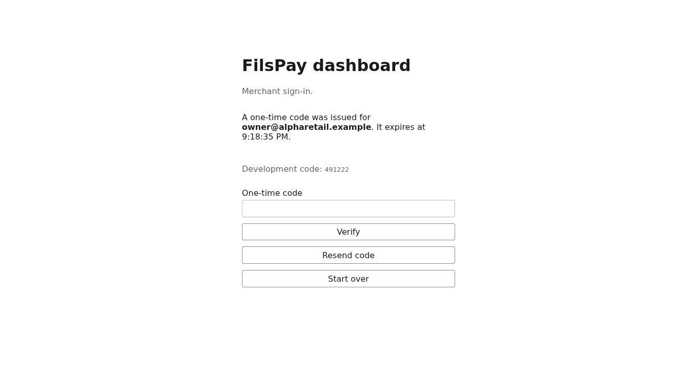 | 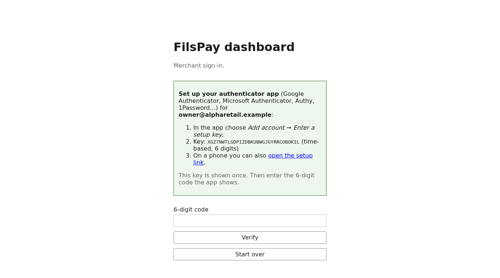 |
| 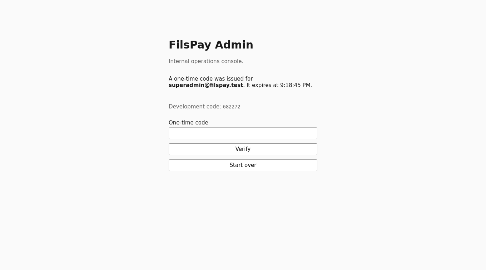 | 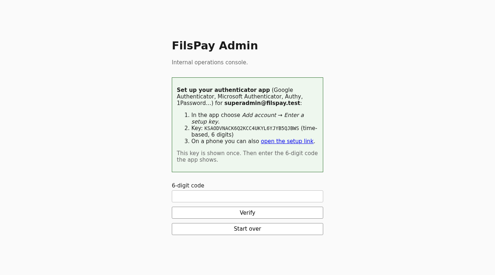 |

### 2. Refunds: the dashboard can finally refund (FP-300)
**What / why.** The refund control existed only as a commented-out file; the transaction page had no way to refund. Now owners and finance users refund a full or partial amount (BD, three decimals, converted to integer fils), one idempotency key per attempt, with the refunded amount, the new status and a negative event in the timeline.

| Before: no refund control, no refunded amount | After: transaction with Refund control |
|---|---|
| 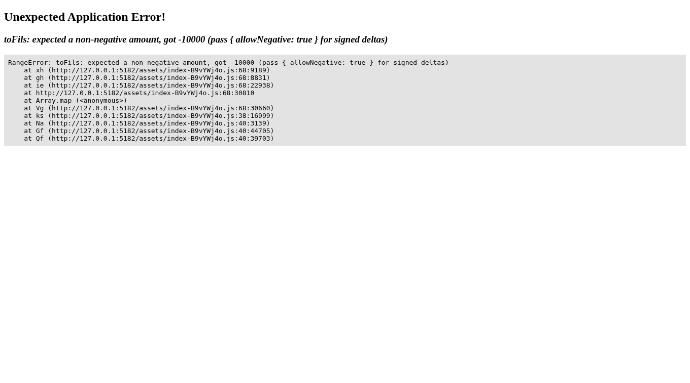 | 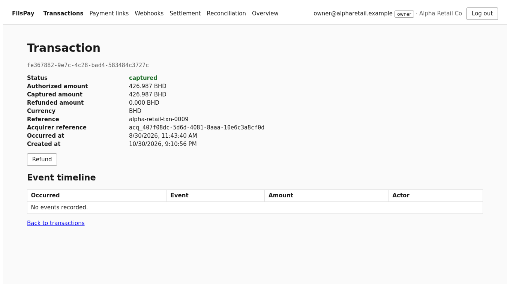 |

| After: refund drawer (10.000 BD of 426.987 BD) | After: `partially_refunded`, refunded amount and the timeline event |
|---|---|
| 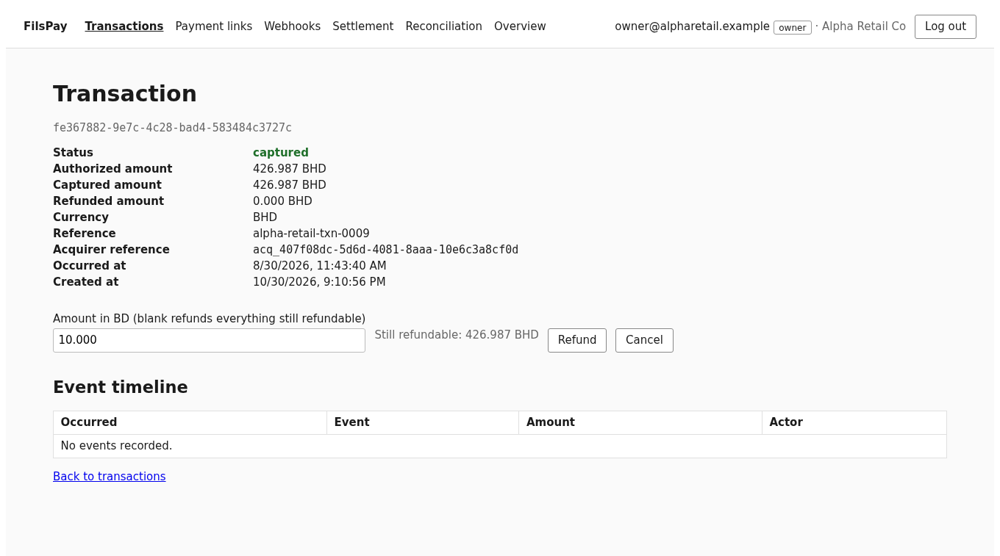 | 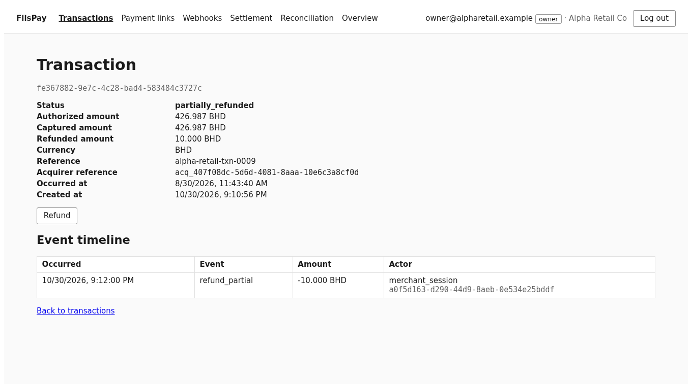 |

### 3. Reconciliation explains refunds, and negative amounts no longer blank the page
**What / why.** The reconciliation report could not account for refunds; a refund-only batch (negative net) or a negative reconciliation figure made the page's money formatter throw. The report now shows refunds that no batch has absorbed yet as part of the pending figure and still ties out to a zero gap; negative amounts render.

| Before | After: refund pending, gap 0.000 BHD |
|---|---|
| 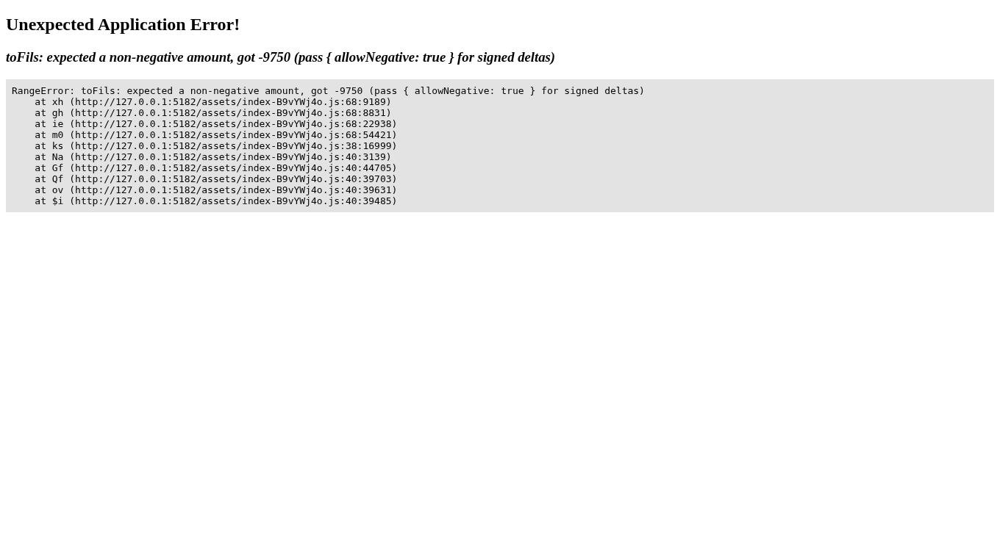 | 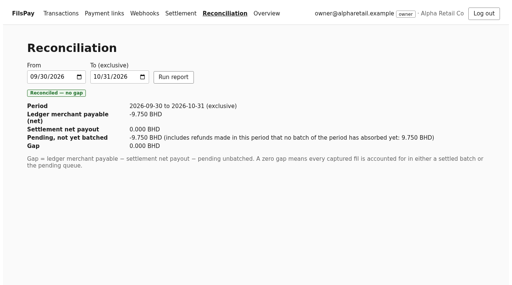 |

### 4. Settlement batches show the refunds they absorbed
**What / why.** A payout is gross − fee − refunds + the fee given back; the batch pages now show the refund terms so a merchant can see why a payout is smaller.

| Before | After: Refunds column |
|---|---|
| 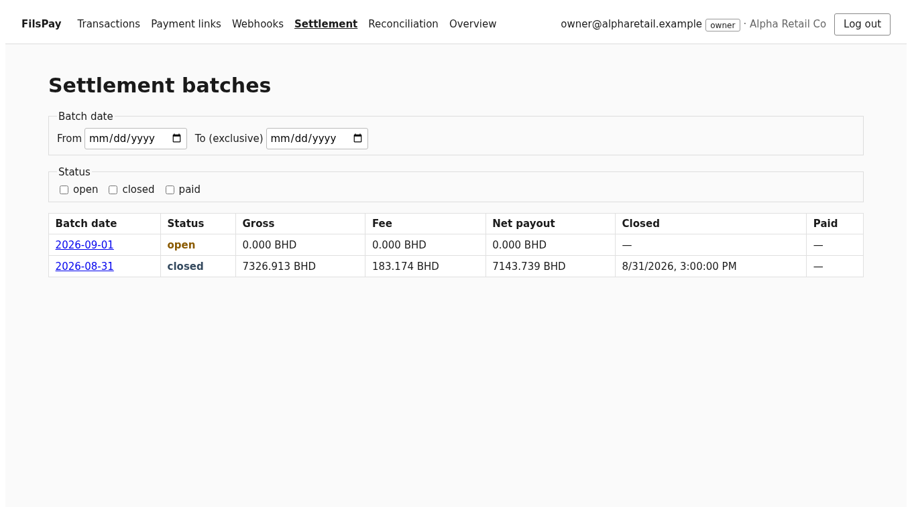 |  |

### 5. Admin console
- **Re-run a daily batch** now defaults to the previous *Bahrain* day (it was the previous UTC day for three hours after Bahrain midnight, AUD-051): 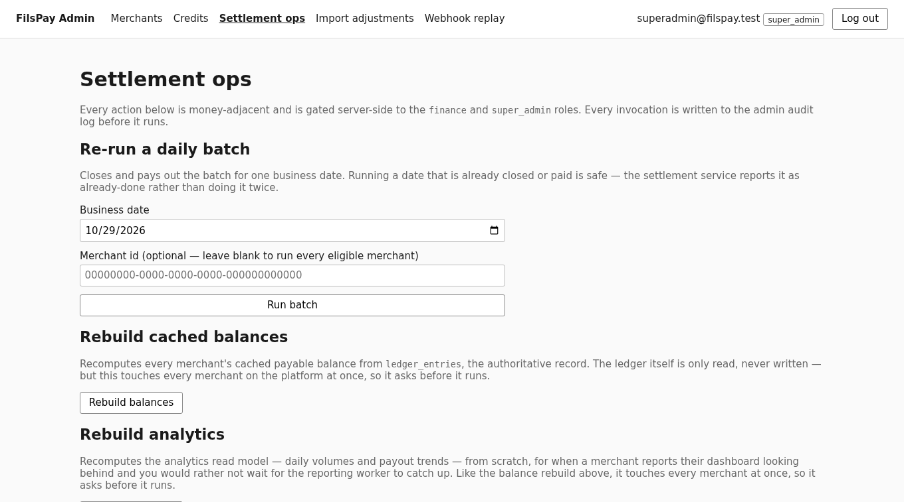
- **Import adjustments**: submitting the same CSV twice now stops with a clear message and an explicit "Import anyway" (AUD-036, previously every row posted twice). The amount parser reads three decimals (AUD-012: 4.75 BD used to post 0.475). 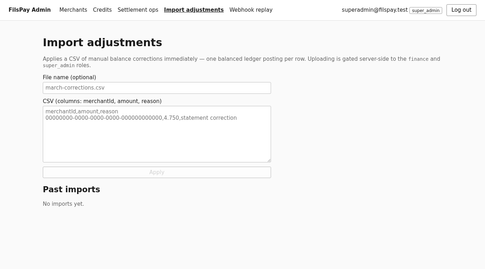
- **Merchant list after sign-in:** 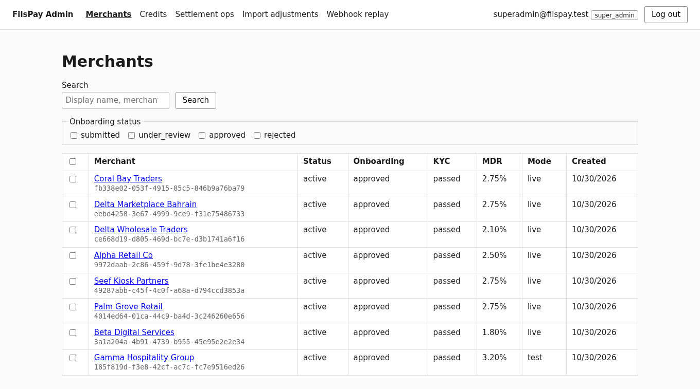

*Not shipped:* a visual redesign of the dashboard was in progress on a separate branch and is not part of this submission.
